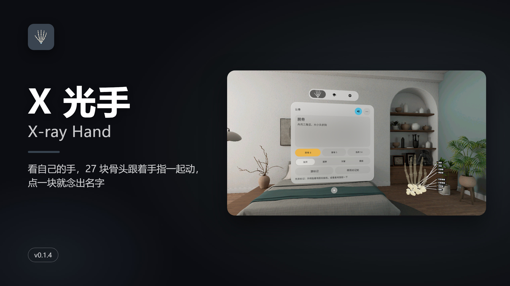
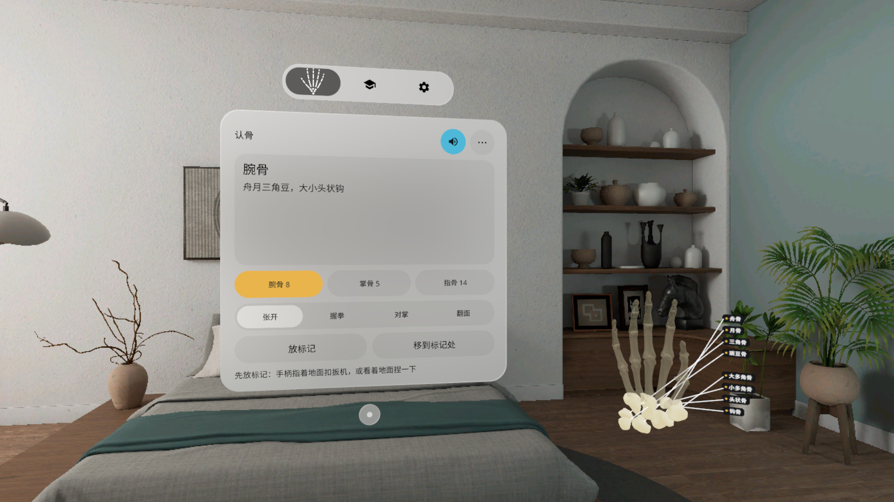
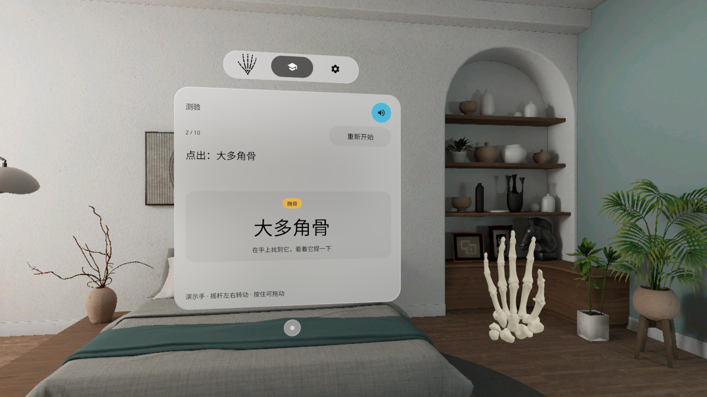
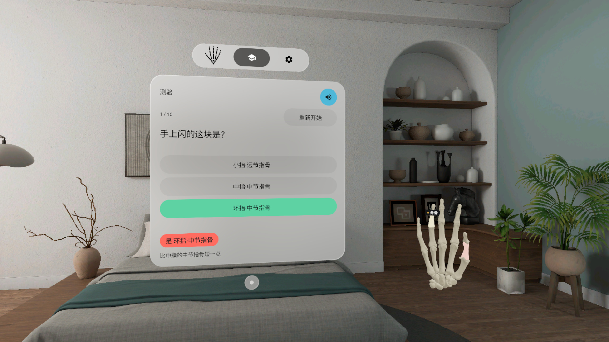
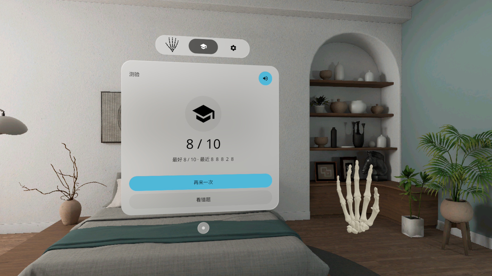
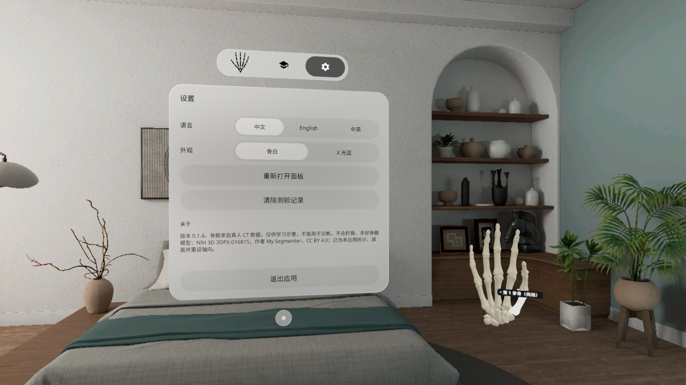
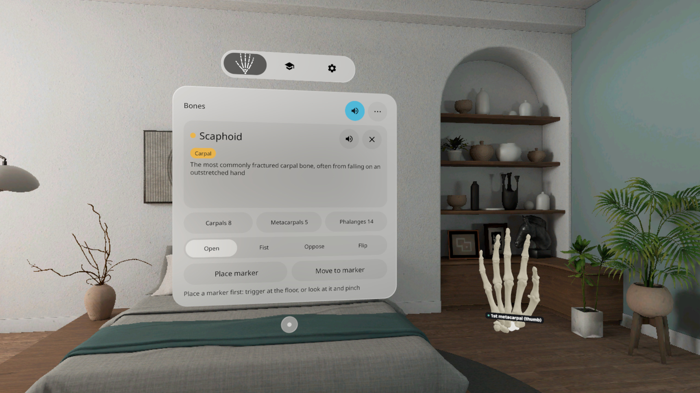
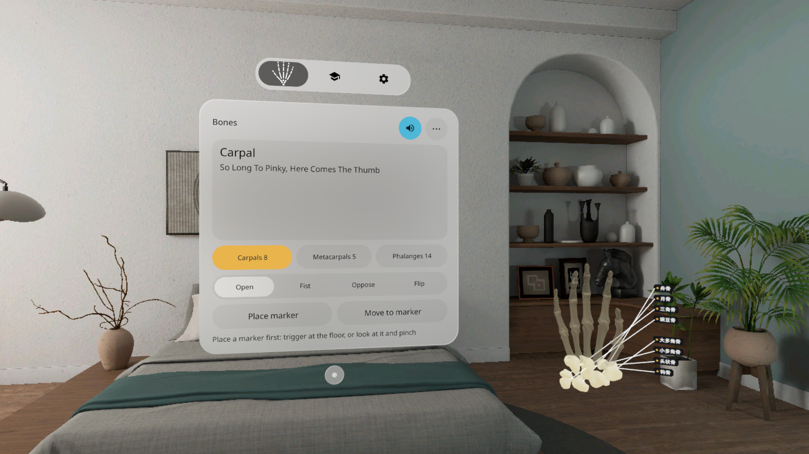
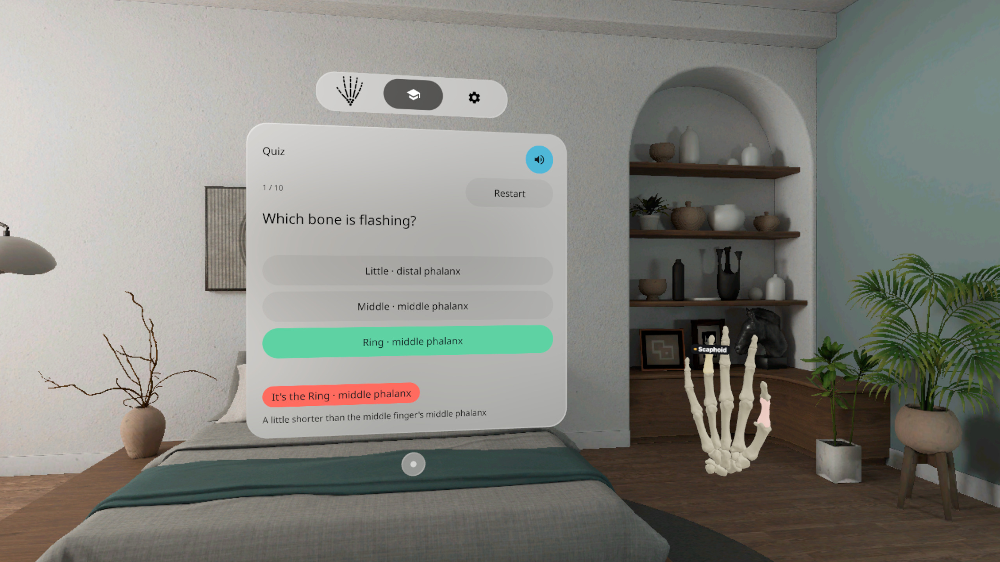
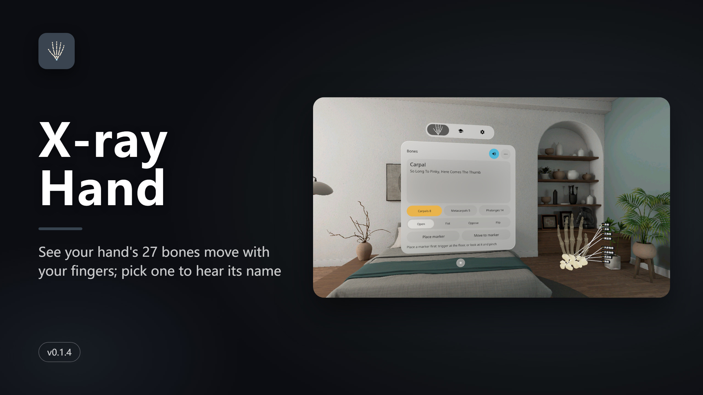

# X 光手 X-ray Hand



[中文](#中文) · [English](#english)

## 中文

PICO OS 6 空间应用：27 块来自真人 CT 的手骨叠在你自己的手上，跟着手指一起动。用眼睛看一块骨头、捏一下，它的名字就写出来并念给你听；10 题测验检查你认得多少。

### 能做什么

- **认骨**：腕骨 8、掌骨 5、指骨 14 三组，点一组整组高亮并拉出名字标签；张开、握拳、对掌、翻面四个姿势；「跟着做」照着演示手做动作
- **演示手**：手不在视野里时有一只演示手代替，放个标记就能把它挪到你想看的地方
- **测验**：10 题一轮，「点出它」和「这是哪块」两种题；看分数、最好成绩、最近几次，错题逐个回看
- **系统窗口**：文字都在一扇系统窗口里，原生页签切换认骨 / 测验 / 设置；平视前方时才开窗，窗口总是竖直的
- **设置**：中文 / English、象牙白 / X 光蓝外观、重新打开面板、清除测验记录、退出应用
- 全部本机运行，不联网、不需要账号；骨骼仅供学习示意，不能用于诊断

### 截图

| | |
|---|---|
|  认骨·点名：选中舟骨 |  分组：8 块腕骨一起高亮 |
|  测验·点出它 |  测验·这是哪块（答错时标出正确答案） |
|  测验结果 8 / 10 |  设置 |

截图在 PICO 模拟器上拍，用调试命令跳到各个状态，画面里是模拟器的演示手，**非真实手势录像**。

### 安装

[Release v0.1.4](https://github.com/kejing-dev/XRayHand/releases/tag/v0.1.4) 里的 `XRayHand-v0.1.4.apk` 是 `assembleRelease` 出的**未签名**包（给应用商店上架用），不能直接 `adb install`。自己装请从源码出 debug 包，头显开启开发者模式并用 USB 连上电脑：

```bash
./gradlew assembleDebug
adb install -r app/build/outputs/apk/debug/app-debug.apk
pico-cli app launch io.embodit.xrayhand
```

需要 PICO OS 6（Android 15，minSdk 35）。

### 构建

```bash
./gradlew assembleRelease testDebugUnitTest   # 未签名上架包 + 单测 / unsigned store APK + unit tests
```

Spatial SDK 6.1.9，SpatialUI；结构、调试命令和运行时事实见 [AGENTS.md](AGENTS.md)。

### 致谢

手部骨骼模型：NIH 3D 3DPX-016815，作者 My Segmenter，CC BY 4.0；已为本应用拆分、减面并重设轴向。

## English

A PICO OS 6 spatial app: 27 hand bones from a real person's CT scan sit on your own hand and move with your fingers. Look at a bone and pinch: its name is shown and read aloud. A 10-question quiz checks how many you know.

### What it does

- **Bones**: Carpals 8, Metacarpals 5, Phalanges 14; tap a group to light it up with name labels; four poses (Open, Fist, Oppose, Flip); Follow me copies the demo hand
- **Demo hand**: stands in when your hand is out of view; place a marker to move it where you want to look
- **Quiz**: 10 questions a round, Point it out and Which bone; score, best and recent results, review each mistake
- **System window**: all text sits in one system window with a native tab bar for Bones / Quiz / Settings; it opens only when you look level and always stands upright
- **Settings**: 中文 / English, bone white / X-ray blue look, reopen the panel, clear quiz records, exit app
- Fully offline, no account; bones are for learning only, not for diagnosis

### Screenshots

| | |
|---|---|
|  Named bone: Scaphoid |  Group: all eight carpals |
|  Quiz: point it out |  Quiz: which bone (wrong answer shows the right one) |
|  Quiz result 8 / 10 |  Settings |



Screenshots were taken on the PICO emulator, with debug commands jumping to each state and the emulator's demo hand on screen: **not a recording of real hand gestures**.

### Install

`XRayHand-v0.1.4.apk` in [Release v0.1.4](https://github.com/kejing-dev/XRayHand/releases/tag/v0.1.4) is an **unsigned** `assembleRelease` build for store submission; `adb install` rejects it. To install it yourself, build the debug APK, enable developer mode on the headset and connect it over USB:

```bash
./gradlew assembleDebug
adb install -r app/build/outputs/apk/debug/app-debug.apk
pico-cli app launch io.embodit.xrayhand
```

Requires PICO OS 6 (Android 15, minSdk 35).

### Build

```bash
./gradlew assembleRelease testDebugUnitTest
```

Spatial SDK 6.1.9 with SpatialUI; structure, debug commands and runtime facts are in [AGENTS.md](AGENTS.md).

### Credits

Hand bone model: NIH 3D 3DPX-016815 by My Segmenter, CC BY 4.0; split, decimated and re-axed for this app.
